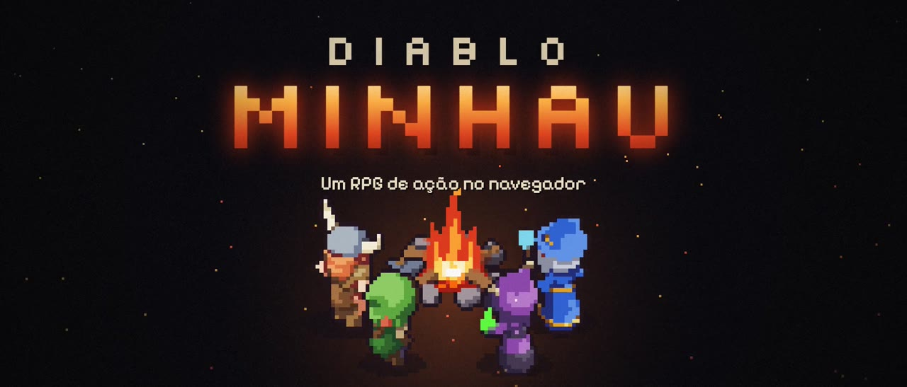
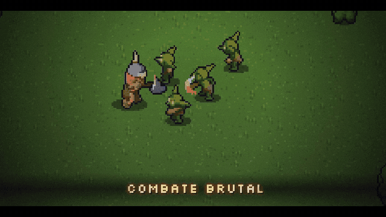
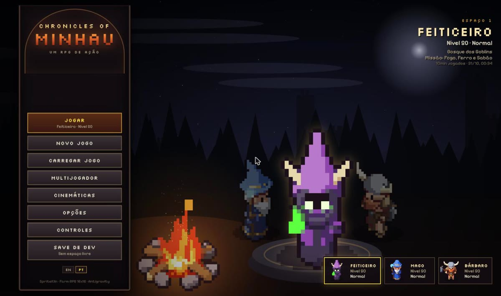
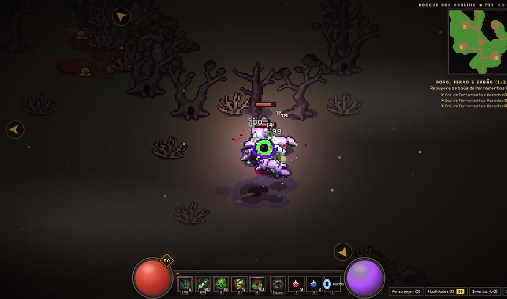
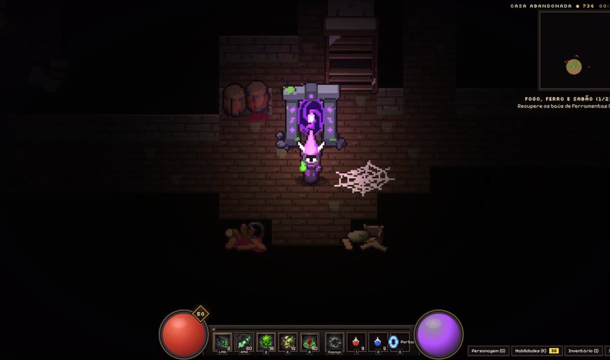
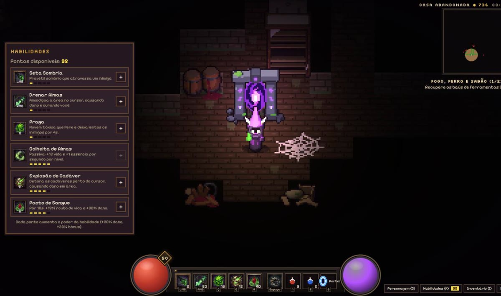
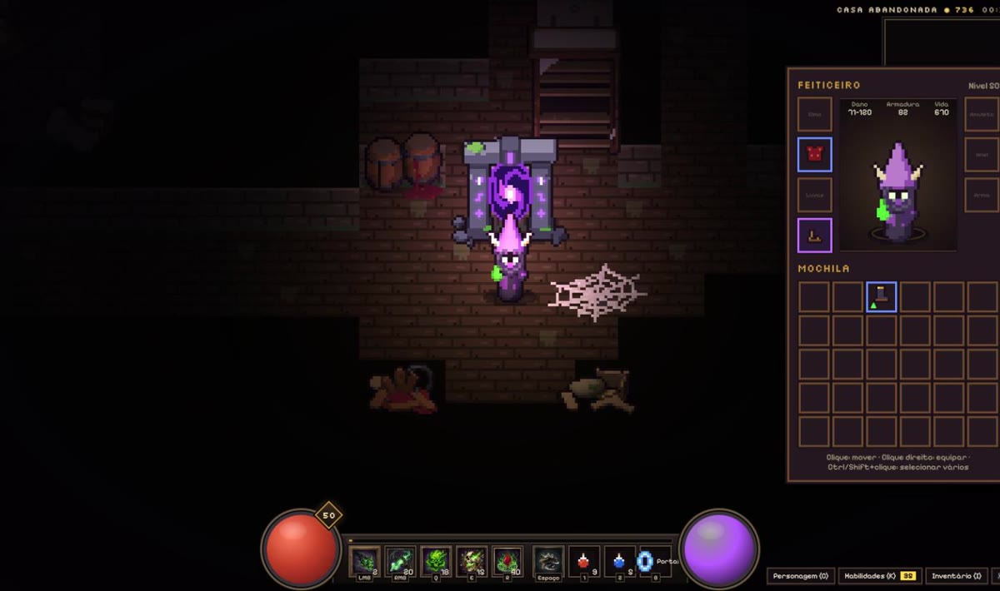
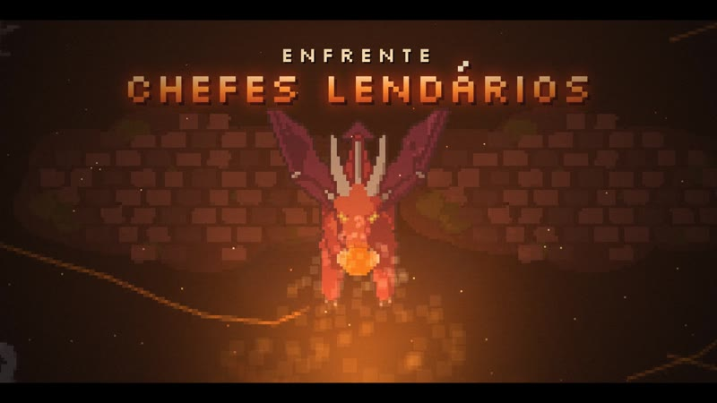
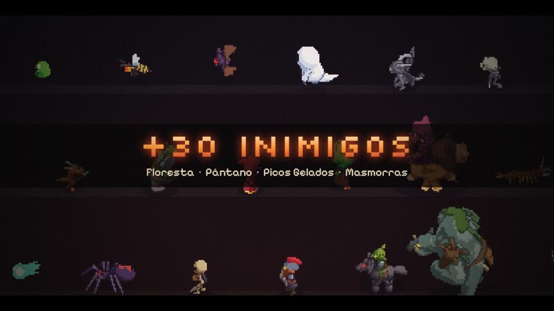
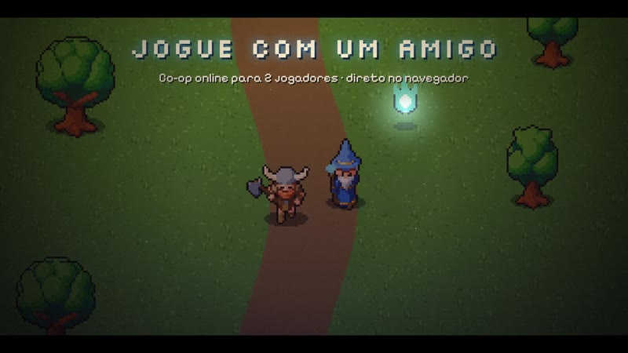

<div align="center">



# Chronicles of Minhau

**Um RPG de ação no estilo Diablo, feito para rodar no navegador.**<br>
Escolha seu herói, limpe masmorras, junte loot e enfrente chefes, sozinho ou com um amigo.

<br>

<a href="https://diablo-minhau.vercel.app">
  
</a>

<br><br>


<br><br>



</div>

---

## 📜 A história

Há dez anos, o reino de **Minhau** caiu numa só noite. Jimmy, o yorkshire da Princesa Sarah, voltou de uma
tempestade transformado em **Jimmynelson**, uma besta colossal, levou a princesa acorrentada e jogou o
**Primeiro Guardião** no abismo. O velho Rei Aldo o recolheu do rio e cuidou dele em segredo por dez anos.

Agora o guardião acorda, e é você. A história completa está em [`HISTORIA.md`](HISTORIA.md).

## ⚔️ O jogo

<table>
  <tr>
    <td width="50%"></td>
    <td width="50%"></td>
  </tr>
  <tr>
    <td align="center"><b>Escolha seu herói</b><br><sub>Bárbaro, Arqueiro, Mago ou Feiticeiro</sub></td>
    <td align="center"><b>Combate rápido</b><br><sub>Habilidades, elementos e números de dano</sub></td>
  </tr>
  <tr>
    <td width="50%"></td>
    <td width="50%"></td>
  </tr>
  <tr>
    <td align="center"><b>Masmorras no escuro</b><br><sub>Iluminação dinâmica com luzes e sombras</sub></td>
    <td align="center"><b>Árvore de habilidades</b><br><sub>Seis habilidades por classe</sub></td>
  </tr>
  <tr>
    <td width="50%"></td>
    <td width="50%"></td>
  </tr>
  <tr>
    <td align="center"><b>Loot em 6 raridades</b><br><sub>Do normal ao único, com loja e comparação de itens</sub></td>
    <td align="center"><b>Chefes lendários</b><br><sub>No fundo de cada masmorra</sub></td>
  </tr>
  <tr>
    <td width="50%"></td>
    <td width="50%"></td>
  </tr>
  <tr>
    <td align="center"><b>Mais de 30 inimigos</b><br><sub>Cada um com mecânicas próprias</sub></td>
    <td align="center"><b>Jogue com um amigo</b><br><sub>Co-op online para 2 jogadores</sub></td>
  </tr>
</table>

## ✨ Destaques

| Recurso | Detalhes |
|---|---|
| 🧙 **4 classes** | Bárbaro, Arqueiro, Mago e Feiticeiro, cada um com sua árvore de habilidades |
| 🗺️ **3 atos** | Floresta de Minhau, Pântano Sombrio e Picos Gelados: 13 áreas e 9 masmorras |
| 💀 **Mais de 30 inimigos** | Lobos, goblins, lagartos, fantasmas, gárgulas, dragões e chefes únicos |
| 💎 **Loot** | 6 raridades, loja, quests e 3 espaços de save |
| 🔥 **4 dificuldades** | Do fácil ao pesadelo |
| 🤝 **Multijogador** | Co-op para 2 jogadores direto no navegador (WebRTC via PeerJS) |
| 🎬 **Cinemáticas** | Prólogo e cenas da história feitos na própria engine |
| 💡 **Iluminação dinâmica** | Luzes que seguem o herói, fogueiras, velas e magias, com relevo nos sprites |
| 🔊 **Áudio por canal** | Volume separado para música, efeitos, ambiente, passos, interface e cinemáticas |

## 🎮 Controles

| Tecla | Ação |
|---|---|
| **Clique esquerdo** | Mover, atacar, falar, pegar itens, entrar em portais |
| **Shift + clique** | Atacar parado |
| **Clique direito** | Habilidade secundária |
| **Q · E · R** | Habilidades da árvore |
| **Espaço** | Esquiva |
| **WASD** | Mover |
| **1 · 2** | Poção de vida · poção de recurso |
| **I · C · K** | Inventário · personagem · habilidades |
| **M** | Ampliar o minimapa |
| **Esc** | Menu de pausa e opções |

## 🛠️ Rodando localmente

```sh
npm install
npm run dev     # http://localhost:5180
npm run build   # gera dist/
```

## 🎨 Créditos

- Personagens, inimigos e efeitos: modelados com [SpriteKiln](https://github.com/LucasJRamos/spritekiln) (`art/specs/`)
- Terreno: *Farm RPG FREE 16x16 - Tiny Asset Pack*
- Ícones de habilidade: gerados com Antigravity
- Engine: [Phaser 3](https://phaser.io)

<div align="center">
<br>
<a href="https://diablo-minhau.vercel.app">
  
</a>
</div>
